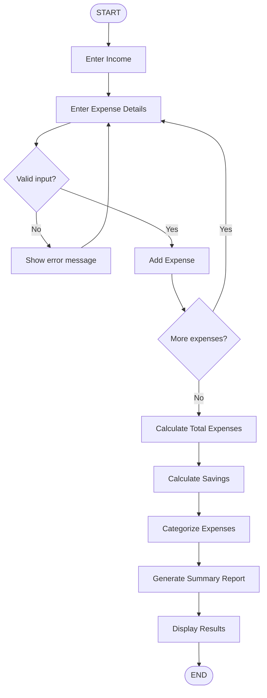

# Personal Expense Calculator

A responsive, frontend-only expense tracker built with **HTML5, CSS3 and Vanilla JavaScript (ES6+)**. It accepts income and expenses, calculates savings, categorizes spending and shows a summary report.

## Problem Statement
Develop a program that accepts income and expense details, calculates savings, categorizes expenses, and displays a summary report.

## Objectives
Practise variables, arrays, objects, functions, conditions, loops, array methods, DOM manipulation, event handling and form validation.

## Features
- Add/update monthly income with validation
- Add multiple expenses (name, amount, category) and delete any of them
- Live dashboard: total income, expenses, savings
- Category-wise totals, highest expense, highest spending category
- Savings message (saving / fully utilized / overspending)
- Reset All with confirmation
- Responsive layout (Grid, Flexbox, media queries)

## Technologies
HTML5 · CSS3 · Vanilla JavaScript (no frameworks, backend, database or APIs)

## Project Structure
```
personal-expense-calculator/
├── index.html
├── css/style.css
├── js/script.js
└── README.md
```

## Programming Concepts Demonstrated
| Concept | Where |
|---|---|
| `let` / `const` | `income`, `expenses`, `CATEGORIES` |
| Arrays & objects | `expenses = [{ id, name, amount, category }]` |
| Functions | `addExpense`, `deleteExpense`, `calculateTotalExpenses`, `calculateSavings`, `calculateCategoryTotals`, `generateSummary`, `validateExpense`, `resetCalculator` |
| Conditions | validation, savings message, highest-expense check, empty-list check |
| Loops / array methods | `for...of`, `forEach`, `map`, `reduce`, `findIndex` |
| DOM & events | `createElement`, `textContent`, `addEventListener` (submit, click) |

## Pseudocode

### Human-generated (replace with your own draft before submitting)
```text
START
Get monthly income
WHILE user wants to add an expense
    Get expense name, amount, category
    Validate expense details
    Add expense to expense list
END WHILE
Calculate total expenses
Calculate savings = income - total expenses
Categorize expenses
Generate summary report
Display results
END
```

### AI-generated
```text
INITIALIZE income = 0, expenses = [], categories = [Food, Transport, ...]

FUNCTION setIncome(input)
    IF input is empty OR not a number OR input <= 0 THEN show error; RETURN
    income = input
    refreshDashboard()

FUNCTION addExpense(name, amount, category)
    IF name is empty THEN error
    ELSE IF amount is not a number OR amount <= 0 THEN error
    ELSE IF category is empty THEN error
    ELSE push {id, name, amount, category} to expenses; refreshDashboard()

FUNCTION deleteExpense(id)
    remove expense with matching id; refreshDashboard()

FUNCTION refreshDashboard()
    total = SUM of all expense amounts
    savings = income - total
    totals = map of category -> 0
    FOR EACH expense: totals[expense.category] += expense.amount
    highest = expense with max amount (or none if list empty)
    topCategory = category with max total (or none)
    IF savings > 0 message = "saving"
    ELSE IF savings == 0 message = "fully utilized"
    ELSE message = "overspending"
    render cards, list, category breakdown, summary

FUNCTION resetAll()
    IF user confirms THEN income = 0; expenses = []; refreshDashboard()
```

## Flowchart


## Human vs AI Comparison
_Draft: edit this to reflect your own pseudocode._

| Aspect | Human Solution | AI Solution |
|---|---|---|
| Problem understanding | Focused on the main flow: input → calculate → display | Also covered delete, reset and edge cases |
| Logic design | Linear loop that adds expenses, then calculates once | Event-driven; one `refreshDashboard()` runs after every change |
| Pseudocode | Short, high-level | Function-based, more detailed |
| Simplicity | Simpler to read | Slightly longer but easier to turn into code |
| Error handling | Basic "validate" step | Separate checks for empty, non-numeric, zero/negative, missing category |
| Efficiency | Recalculates once at the end | Recalculates after each change (fine for small lists) |
| Final implementation | Core idea of the program | Function structure and refresh pattern |

**Useful ideas from AI:** one `refreshDashboard()` function so delete and reset stay in sync, unique ids for deleting, and detailed validation. **Manual changes:** friendlier messages, ₹ formatting, simpler UI, and the Reset confirmation.

## How to Run
Open `index.html` in any browser, or use the VS Code *Live Server* extension.

## Screenshots
_Add screenshots here._

## Future Enhancements
Save data with `localStorage`, edit expenses, charts, monthly budgets, CSV export, dark mode.
